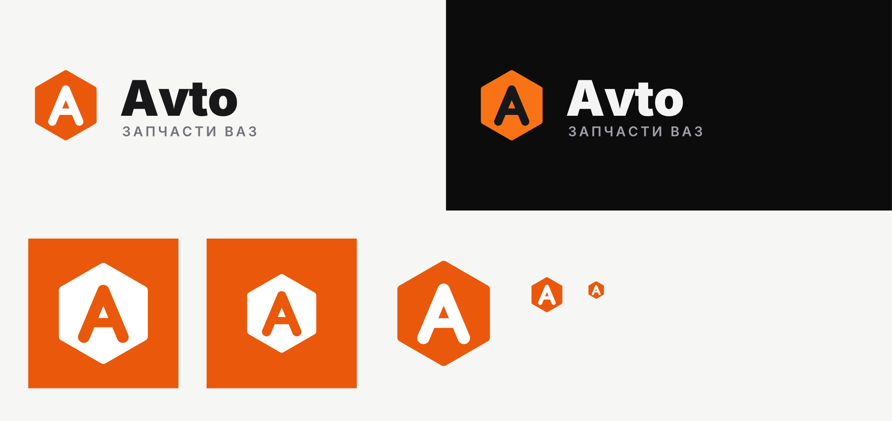

# Фирменный стиль Avto

Магазин оригинальных запчастей ВАЗ (LADA).

**Знак** — шестигранная гайка с буквой «А». Собственный рисунок: логотипы LADA и АвтоВАЗ (ладья) — товарные знаки, их не используем. Слова «ВАЗ», «LADA» допустимы только в тексте как описание товара («запчасти для LADA Vesta»).

## Файлы

| Файл | Где использовать |
|---|---|
| `logo.svg` | основной логотип на светлом фоне |
| `logo-dark.svg` | на тёмном фоне |
| `logo-mono.svg` | одноцветная печать: накладные, ценники, штамп |
| `mark.svg` | знак без текста: аватарки соцсетей, favicon, водяной знак |
| `app-icon.svg`, `app-icon-1024.png` | иконка приложения (App Store / Google Play, Expo `icon`) |
| `adaptive-icon-foreground-1024.png` | Android adaptive icon (Expo `android.adaptiveIcon.foregroundImage`, фон `#EA580C`) |

Текст в логотипах переведён в кривые — шрифт на компьютере не нужен.

Уже подключено:
- сайт: `web/src/app/icon.svg`, `favicon.ico`, `apple-icon.png`, `public/icons/*` (PWA), логотип в шапке — `web/src/components/logo.tsx`;
- админка: `backend/public/admin-assets/*`.

## Цвета

| | HEX | |
|---|---|---|
| Оранжевый | `#EA580C` | основной, кнопки, знак |
| Оранжевый (тёмная тема) | `#F97316` | |
| Графит | `#18181B` | текст, тёмный фон |
| Серый | `#71717A` | подписи |
| Фон | `#F6F6F4` | |

**Шрифт** — Inter (Black 900 для названия, SemiBold 600 для подписи «ЗАПЧАСТИ ВАЗ» с разрядкой).

## Правила

- Минимальный размер знака — 16 px, логотипа с текстом — 120 px по ширине.
- Вокруг логотипа оставлять поле не меньше половины высоты знака.
- Не менять цвета знака, не вращать, не добавлять тени и обводки.
